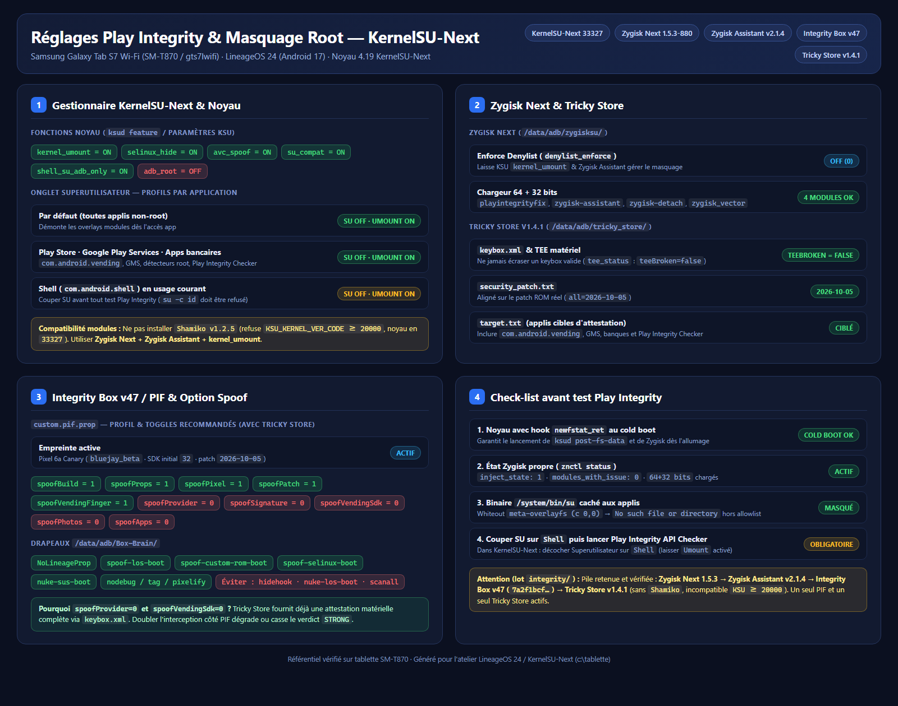

# Guide des réglages Play Integrity — KernelSU-Next (`SM-T870` / LineageOS 24)

Réglages vérifiés pour la pile active sur la tablette **Samsung Galaxy Tab S7 Wi-Fi (`SM-T870` / `gts7lwifi`)** sous **LineageOS 24 (Android 17)** avec **KernelSU-Next (`33327`)**.

## 1. Gestionnaire KernelSU-Next & fonctions noyau

- **Modules incompatibles à éviter** : ne pas installer `Shamiko v1.2.5 (414)` — son script bloque sur `KSU_KERNEL_VER_CODE >= 20000` (noyau actuel en `33327`).
- **Pile fonctionnelle retenue (lot vérifié `integrity/install-modules.bat`)** :
  - `Zygisk Next` (`1.5.3-880`)
  - `Zygisk Assistant` (`v2.1.4` release — évite `Shamiko`, fermé/incompatible `KSU >= 20000`, et rend `vbmeta-fixer` superflu)
  - `Integrity Box` (`v47`, empreinte officielle `7a2f1bcf…`) — ne **jamais** activer un second module PIF (`PlayIntegrityFork`) en parallèle
  - `Tricky Store` (`v1.4.1`, un seul module)
  - `meta-overlayfs` (`1.3.1`) + modules locaux (`tab-s7-opt`, etc.)
- **Fonctions noyau (`ksud feature`)** :
  - Actives (`ENABLED`) : `kernel_umount`, `selinux_hide`, `avc_spoof`, `su_compat`, `shell_su_adb_only`.
  - Désactivée (`DISABLED`) : `adb_root`.
- **Onglet Superutilisateur par application** :
  - **Par défaut (applis non-root)** : `SU = OFF`, `Umount modules = ON`.
  - **Google Play Store (`com.android.vending`), Google Play Services, bancaires, détecteurs root, Play Integrity API Checker** : `SU = OFF`, `Umount modules = ON`.
  - **Shell (`com.android.shell`)** : garder `SU = OFF` et `Umount modules = ON` hors maintenance ADB (`su -c id` doit renvoyer `Permission denied`).

## 2. Zygisk Next & Tricky Store

- **Zygisk Next (`/data/adb/zygisksu/`)** :
  - `denylist_enforce = 0` (`OFF`) : laisser `kernel_umount` de KernelSU-Next et `Zygisk Assistant` assurer le démontage/masquage sans bloquer le chargement des modules.
- **Tricky Store v1.4.1 (`/data/adb/tricky_store/`)** :
  - `keybox.xml` : la keybox active est une keybox **tierce (fuitée)** chargée par Integrity Box, pas la clé matérielle de la tablette. C'est elle qui donne `STRONG`, et Google peut la révoquer à tout moment (retour à `DEVICE`). Ne pas l'écraser sans sauvegarde (`Box-Brain/KeyBackup`).
  - `security_patch.txt` : `all=2026-10-05` (aligné sur le correctif de sécurité réel de la ROM).
  - `target.txt` : lister `com.android.vending`, GMS, les applications bancaires et les outils Play Integrity.

## 3. Option `Spoof` (Integrity Box v47 / `custom.pif.prop`)

Avec **Tricky Store** actif et un `keybox.xml` valide (`teeBroken=false`), seuls les spoofs d'identité ROM/fingerprint doivent être activés :

| Clé (`custom.pif.prop`) | Valeur recommandée | Rôle |
|---|---:|---|
| `spoofBuild` / `spoofProps` | `1` | Masque le fingerprint LineageOS/`userdebug` vers Pixel certifié |
| `spoofPixel` | `1` | Compatibilité props Pixel pour GMS DroidGuard |
| `spoofPatch` | `1` | Aligne le niveau de patch envoyé |
| `spoofVendingFinger` | `1` | Aligne l'empreinte côté Play Store |
| `spoofProvider` / `spoofSignature` | `0` | **À couper** : redondant et conflictuel avec Tricky Store (`STRONG`) |
| `spoofVendingSdk` | `0` | **À couper** : inutile/risqué sous Android 17 + Tricky Store |
| `spoofPhotos` / `spoofApps` | `0` | Optionnel/hors Play Integrity |

Drapeaux `/data/adb/Box-Brain/` sûrs : `NoLineageProp`, `spoof-los-boot`, `spoof-custom-rom-boot`, `nuke-sus-boot`, `nodebug`, `tag`, `pixelify`.  
Drapeaux à **éviter** (risque de bootloop / instabilité) : `spoof-selinux-boot` (marqué « bootloop risk » par Integrity Box, et inutile ici car SELinux est réellement `Enforcing`), `hidehook`, `nuke-los-boot`, `scanall`.

> Note : l'image ci-dessus affiche encore `spoof-selinux-boot` en vert. Le texte fait foi tant qu'elle n'est pas régénérée.
